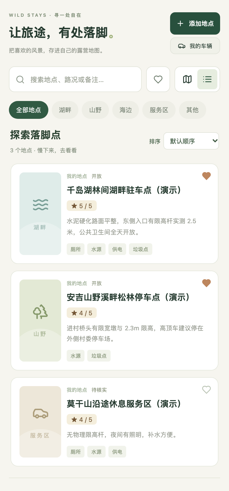
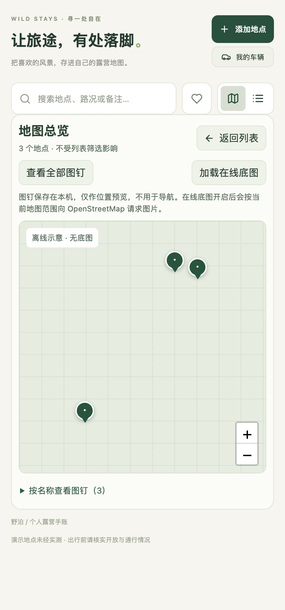
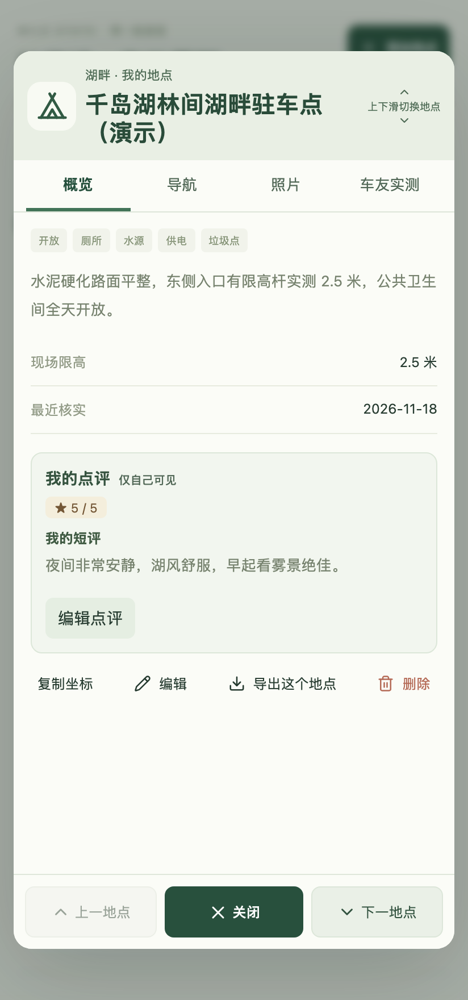
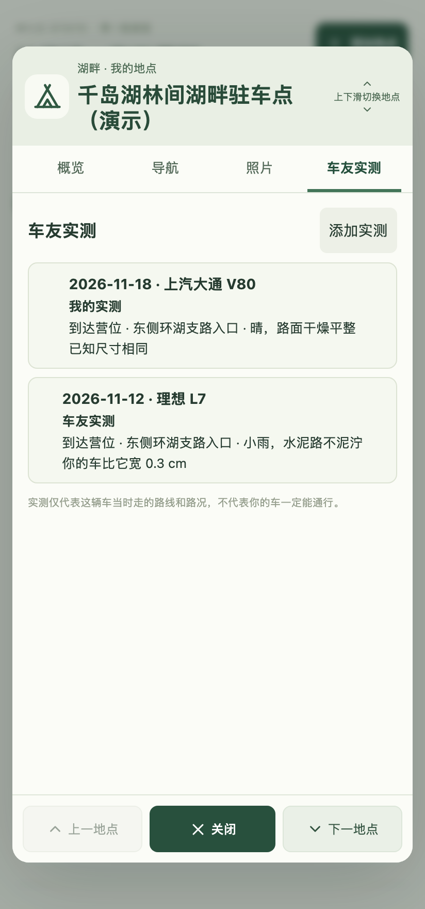
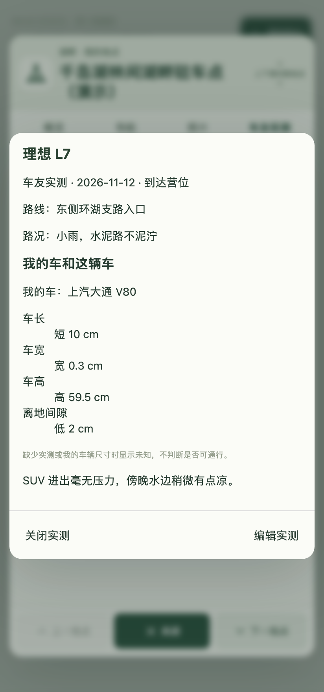
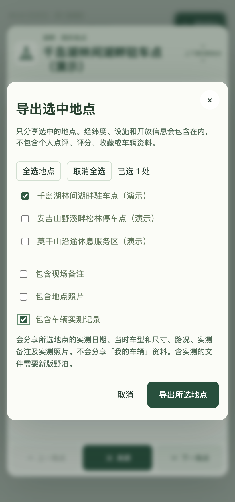
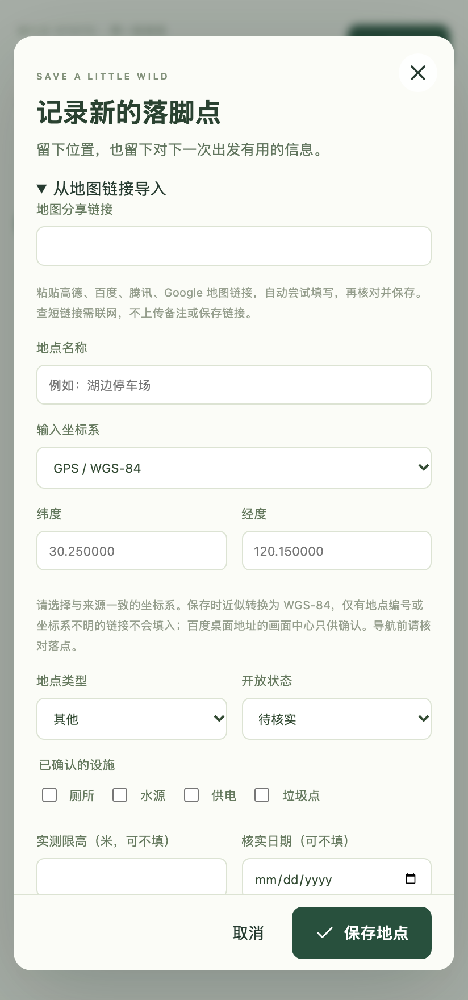

# ⛺ 野泊 · 床车露营地图 (YeBo)

**WILD STAYS · 寻一处自在 —— 让旅途，有处落脚。**

专为自驾床车与露营爱好者打造的**离线优先营地记录、多源地图链接解析与车友实测对比工具**。

- **正式版版本**：`v1.0.0`（`versionCode: 13`）
- **固定应用包名**：`com.jlmac.yebo`
- **系统支持**：Android 7.0（API 24）及以上
- **存储架构**：100% 纯本地离线存储，无账号、无云同步、零后台自动上传

## 📥 立即下载与安装（Android 正式版 v1.0.0）

**野泊 v1.0.0** 已完成正式长期证书签名（固定应用 ID：`com.jlmac.yebo`，`versionCode: 13`），后续版本使用同一包名和签名、递增版本号即可覆盖安装。

- **正式版安装包**：请在仓库右侧 **Releases** 页面下载 `Yebo-1.0.0.apk`（详情参见 [野泊 1.0.0 版本说明与迁移指南](docs/YEBO-1.0.0.md)）
- **安装包校验 (SHA-256)**：
  ```text
  97f967adcf5dbe6bfe3728c6903940cb17ea8ef1e6a9a058aaf71bc4ccae03e0  Yebo-1.0.0.apk
  ```

> **从早期测试版（0.3.2 及更早版本）升级提示**：
> 正式版使用独立包名 `com.jlmac.yebo`，可与旧测试包并装。请先在旧测试版中点击 **「导出备份」** 保存完整 JSON 文件，安装正式版「野泊」后点击 **「恢复我的备份」**（如需恢复车型数据请勾选 **「同时恢复备份中的车辆资料」**），核对地点、照片、私人点评与实测记录无误后再卸载旧测试包。

## 📱 真实界面一览

### 1. 首页营地列表、离线地图总览与地点详情
| 探索落脚点（首页列表） | 离线地图图钉总览 | 地点详情与私人点评 |
| :---: | :---: | :---: |
|  |  |  |

### 2. 车友实测记录、车型尺寸差值对比与选点导出分享
| 车友实测与我的实测列表 | 我的车与实测车尺寸差值对比 | 导出选中地点（按需勾选字段） |
| :---: | :---: | :---: |
|  |  |  |

### 3. 记录新的落脚点与多源地图分享链接导入
<p align="center">
  
</p>

## ✨ 为什么做「野泊」？

开床车或露营车出门，最常遇到三个痛点：
1. **散落在各处的营地收藏**：车友群发的高德短链、百度地图看点、腾讯位置或 Google 坐标分散在聊天记录里，到了没信号的山谷根本翻不到。
2. **「别人能进，我的车能进吗？」**：轿车或 SUV 能轻松通过的林道和限高杆，中高顶宿营车或带顶帐的床车未必能过。
3. **隐私与分享的冲突**：想把好营地和实测路况分享给车友，但不想把自己的私人打分、私人短评或个人爱车档案一并暴露出去。

**野泊 (YeBo)** 就是一个**纯本地、零后台、离线可用**的个人露营手账与营地库：不设账号、不绑云端，所有数据 100% 掌握在自己手机里，同时支持一键解析主流地图链接、对比车友到访车型尺寸差值，以及按需勾选字段同车友互传营地。

## 🚀 核心功能详解

### 1. 📍 营地库与离线图钉总览
- **结构化营地档案**：按「湖畔、山野、海边、服务区、其他」分类管理，记录营地名称、WGS-84 经纬度、已确认设施（厕所、水源、供电、垃圾点）、开放状态（待核实 / 开放 / 关闭）、实测限高（米）、核实日期与现场备注。
- **离线图钉总览 + 按需在线底图**：Android 与网页端默认进入清爽列表页；切换到「地图总览」可在**完全离线（无底图请求）**状态下查看全部营地图钉相对分布并点击进入详情；有网络时可手动点击「加载在线底图」开启 [OpenStreetMap](https://operations.osmfoundation.org/policies/tiles/) 瓦片。
- **本地相册缩略图**：每个营地支持添加最多 **3 张本机相册照片**，应用内自动缩小为 JPEG，支持详情看大图，并随 JSON 备份导出与恢复（不上传照片，也不读取照片 EXIF 坐标）。
- **单手友好切换**：地点详情支持左右横向滑动翻页、页头上下滑切换地点，以及底部固定「上一地点 / 关闭 / 下一地点」按钮。

### 2. 🔗 多源地图链接导入与一键导航导出
- **粘贴长短链自动解析**：在「记录新的落脚点 → 从地图链接导入」中，支持粘贴**高德地图、百度地图、腾讯地图、Google Maps** 地点长链接；Android 端支持自动跟进受支持的地图短链接跳转，也支持从其他地图 App 通过 **Android 系统分享 (`text/plain`)** 直接导入野泊。
- **多坐标系自动换算**：支持录入 **WGS-84、GCJ-02（高德/腾讯）、BD-09（百度）** 坐标，保存时自动近似换算为统一 WGS-84 坐标；若表单已有手填坐标，粘贴链接时会提示确认而非静默覆盖。
- **多端路线与看点拉起**：
  - **高德路线规划**：一键发起 [高德 HTTPS 路线规划](https://lbs.amap.com/api/uri-api/guide/travel/route)（Android 优先拉起高德地图 App 官方路线 Intent，未安装时退回网页）。
  - **百度地图看点**：Android 端点击「百度地图看点」优先在百度地图 App 内定位显示同一坐标点位，不自动开启导航；未安装时切换官方网页。
  - **Google Maps & 坐标复制**：支持一键跳转 [Google Maps URLs](https://developers.google.com/maps/documentation/urls/get-started) 导航或直接复制标准 WGS-84 经纬度。

### 3. 🚐 「我的车辆」档案与车友实测尺寸对比
- **常见车型尺寸库**：「我的车辆」支持先选品牌再选车型，内置常见车型官方**车长、车宽、车高**预设并附官方数据来源；支持随时按改装后实测值（含**离地间隙**）手动修改，未收录车型可直接手填。
- **多次到访实测记录**：添加新地点时可顺手填写首条「我的实测」（自动带入当前车辆，仅收藏未到访可留空）。同一地点可保留多条带日期的「我的实测」与导入的「车友实测」，记录开到了哪里（到达营位 / 只到停车场或入口 / 途中掉头 / 其他）、入口路线与当时路况。
- **四维尺寸差值对比**：点开任一条实测记录，自动对比「我的车和这辆车」的**车长、车宽、车高、离地间隙**差值（精确到 cm，如 `短 10 cm`、`高 59.5 cm`），仅提供客观数值对照，不自动判断能否通行。

### 4. 🤝 隐私优先的车友分享 vs. 完整个人备份
野泊将 **「分享地点给车友」** 与 **「个人完整备份」** 严格区分在不同入口，避免误发私人数据或误覆盖本机库：

| 维度 | 🤝 导出选中地点（分享给车友） | 💾 导出备份 / 恢复我的备份 (JSON v2) |
| :--- | :--- | :--- |
| **设计目的** | 与车友交换单个或一批营地点位 | 本机数据定期防丢、换机或跨版本迁移 |
| **基础位置与设施** | 包含（名称、经纬度、限高、设施、开放状态） | 包含全部营地完整字段 |
| **备注、照片、实测** | **按需主动勾选**（包含现场备注 / 地点照片 / 车辆实测记录） | 完整保留（含最多 3 张压缩照片与实测来源） |
| **私人评分与短评** | **自动剔除**（「我的点评」仅自己可见） | 完整保留在地点详情「概览」中 |
| **收藏状态 & 我的车辆** | **自动剔除** | 完整保留（恢复时可勾选是否同时恢复车辆资料） |
| **导入冲突保护** | 「导入车友地点」先展示合并预览，确认后才写入 | 独立「恢复我的备份」入口，支持 v1/v2 备份格式 |

## 🛠️ 技术栈与工程结构

- **前端与跨平台底座**：React 19 + Vite 7 + Leaflet 1.9 + [Capacitor Android](https://capacitorjs.com/docs/android)
- **图标与界面**：Lucide React + 响应式移动优先 CSS + 108dp Android 自适应矢量图标
- **质量与云端构建**：Node.js 原生测试 (`node --test`) + Playwright 移动端冒烟回归 + GitHub Actions 云端 Android 编译与 APK 元数据校验

```text
camping-map/
├── android/                  # Capacitor Android 原生工程与 Gradle 配置 (com.jlmac.yebo)
├── docs/                     # 产品方案、交接文档、回归清单与 README 真实界面截图
│   ├── assets/               # Playwright 实机视口渲染的 7 张真实界面截图
│   ├── product/              # 完整产品设计与技术架构方案原文
│   ├── ANDROID-REGRESSION.md # Android 交付回归清单
│   ├── ANDROID-RELEASE.md    # Android 正式版签名与发布规范
│   ├── QA.md                 # 验收记录与边界说明
│   └── YEBO-1.0.0.md         # v1.0.0 正式版发布与迁移说明
├── src/                      # 前端核心源码
│   ├── main.jsx              # 应用主视图、列表筛选与表单编排
│   ├── place-detail.jsx      # 营地详情、横向翻页与外部地图动作
│   ├── place-overview.jsx    # 离线地图图钉总览与按需在线底图
│   ├── place-review.jsx      # 地点概览中的私人评分与短评
│   ├── place-visits.jsx      # 到访实测记录与车型尺寸差值对比
│   ├── place-exchange-ui.jsx # 车友分享勾选、导入合并预览与备份恢复弹窗
│   ├── map-link.js           # 高德/百度/腾讯/Google 地图链接解析器
│   ├── coordinates.js        # WGS-84 / GCJ-02 / BD-09 坐标转换
│   └── vehicle-catalog.js    # 常见车型品牌与官方尺寸目录
├── tests/                    # 59 项单元测试与 Playwright 移动端回归脚本
└── tools/                    # Release APK 校验、图标生成、真实截图与一键发布脚本
```

## 💻 本地开发与测试（无需本地安装 Android SDK）

只需要安装 **Node.js 22** 或更新版本，即可在本地完成全部网页端开发与单元测试：

```sh
npm ci
npm test
npm run dev -- --port 5173
npm run build
```

## ⚠️ 数据与能力边界说明

- **纯本地存储**：野泊不自动上传营地、照片或车辆资料，无账号、无云同步、无后端服务器。清除应用数据或卸载应用会导致未备份记录丢失，请定期点击「导出备份」。
- **坐标换算精度**：WGS-84、GCJ-02 与 BD-09 之间的转换范围采用粗略矩形近似换算，不保证零偏移；百度桌面地点链接中的画面中心点仅作近似参考，保存前请结合原地图链接核对。
- **安全免责**：设施勾选仅代表记录者当时确认具备；实测与车型尺寸差值仅代表该辆车当时走的路线和路况，**不代表你的车一定能安全通行**，出行前请务必现场核实限高与路况。

## 📚 相关工程文档

- [完整产品设计与技术架构方案（原文）](docs/product/original-proposal.md)
- [野泊 1.0.0 版本说明与迁移指南](docs/YEBO-1.0.0.md)
- [Android 正式版签名和发布说明](docs/ANDROID-RELEASE.md)
- [Android 交付回归清单](docs/ANDROID-REGRESSION.md)
- [验收记录 (QA)](docs/QA.md) · [开发续接说明 (RESUME)](docs/RESUME.md)

## iPhone 主屏幕版（PWA）

按以下步骤把野泊添加到 iPhone 主屏幕：

1. 在 iPhone 上用 Safari 打开[野泊 PWA](https://fgyg007.github.io/camping-map/)。
2. 点「分享 → 添加到主屏幕」。如有「作为网页 App 打开」选项，保持开启，再点「添加」。
3. 从主屏幕打开「野泊」，首次打开保持联网，以便缓存应用文件。

自托管可执行 `npm ci` 和 `npm run build`，将 `dist/` 发布到稳定的 HTTPS 地址，支持站点根目录或带末尾斜线的子目录。

完成首次加载后，营地列表、编辑和图钉总览可以断网使用。在线底图和外部地图服务仍需要网络。网页数据保存在其本地存储中，换域名、清理网站数据或系统回收存储都可能影响访问。可通过「导出备份」和「恢复我的备份」在 APK 和 PWA 之间迁移。

iPhone 真机验收用合成记录进行：从主屏幕打开并核对图标、独立窗口和安全区；开启飞行模式后重新启动、编辑并重开检查数据；从相册选择照片并验证常见格式；在「文件」中保存和重新选取 JSON 备份；联网验证地图跳转并切回野泊，检查操作状态。网页使用浏览器的文件选择与下载能力，后台任务和 Android 的系统分享接收依赖各平台能力。
